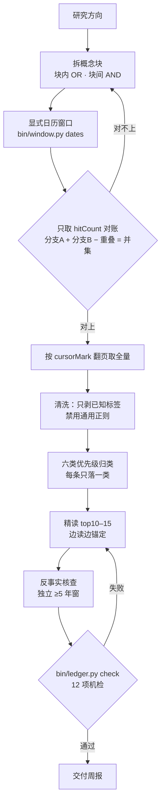

[README.md](https://github.com/user-attachments/files/34371501/README.md)
# YoMLIA

**把一周的医学新文献，压成一份能逐条机器核验的中文周报。**


YoMLIA 是一个跑在 [WorkBuddy](https://www.workbuddy.cn) 里的专家包，专做**生物医学与生命科学**领域的主题式文献追踪：给定一个研究方向和时间窗，它用 Europe PMC 检索式跑全量、用 AI 精读摘要、把每个数字锚定到原文原句，最后交付一份带账目的中文周报。

> 名字念作「YoMLIA」，取 Mediccal Literature Intelligence Analyst。yo是标识

- [它解决什么问题](#它解决什么问题)
- [它不是什么](#它不是什么)
- [效果长什么样](#效果长什么样)
- [怎么工作](#怎么工作)
- [为什么只做生物医学](#为什么只做生物医学)
- [快速开始](#快速开始)
- [换到别的模型](#换到别的模型)
- [三个常用入口](#三个常用入口)
- [几个刻意的设计决定](#几个刻意的设计决定)
- [隐私与数据](#隐私与数据)
- [目录结构](#目录结构)
- [常见问题](#常见问题)
- [已知边界与路线图](#已知边界与路线图)
- [反馈与贡献](#反馈与贡献)
- [许可](#许可)

---

## 它解决什么问题

做科研的人不缺数据库权限，缺的是**确定性**：这一周我这个方向到底出了什么、哪几篇值得读、有没有人刚发了和我相反的结论。

大多数「AI 文献助手」在这里会翻车，翻车点很固定：

| 常见做法          | 后果                             |
| ------------- | ------------------------------ |
| 让模型自己拼检索式     | 拼出来的式子跑不通，或者跑通了但漏了一半           |
| 只取前 10 条结果就总结 | 把「抽样」说成「全量」，用户以为看完了这一周         |
| 摘要改写成中文       | 数字被顺手「润色」成整数，HR 0.79 变成「约 0.8」 |
| 报个「显著改善」不给 CI | 结论无法核对，也无法复现                   |
| 只看支持自己方向的文献   | 一周全是阳性结果，其实是检索偏倚               |

YoMLIA 的做法是把这件事拆成**确定性的一半**和**判断性的一半**，中间用两道机器可跑的校验卡住：

- **筛**交给脚本：检索、翻页、去重、分类、对账，全部可复现；
- **判**交给模型：哪几篇值得读、改变了什么、对你的课题意味着什么；
- **「有没有被自己骗」**&#x4EA4;给交付门：数字必须挂原文逐字摘录和哈希，报告里出现锚定表外的裸数字就拒绝交付。

---

## 它不是什么

写清楚这点比写功能更重要，否则你会拿着错误的期待来用：

- **不是全文精读工具**。只读摘要。需要全文才能确认的（亚组定义、统计方法、补充材料）一律标「需查全文」。
- **不做系统评价 / Meta 分析**。它给证据清单和逐篇要点，不做合并效应量。
- **不查中文文献**。Europe PMC 覆盖不到多数中文期刊，方向以中文文献为主时它会先说明这个缺口。
- **不做临床决策建议**。涉及用药调整、适应证外推，一律附「请以原文与指南为准」。
- **不代写综述 / 标书**。可以给结构化素材，成文是你的活。

---

## 效果长什么样

下面是合成数据（`tests/fixtures/`，PMID 与期刊名均为虚构）产出的片段，用来展示**结构**而不是内容：

```markdown
## 1. 一句话结论
本周该主题新增 42 条，其中 1 项 III 期 RCT 改变了 HFpEF 的用药证据等级，
另有 1 篇勘误纠正了上一批文献里的样本量。

## 2. 账目表
| 分支 | 检索式 | 命中 |
|---|---|---|
| A 疾病 | MESH:"Heart Failure" + TITLE_ABS 自由词 | 31 |
| B 药物 | TITLE_ABS:(empagliflozin OR dapagliflozin ...) | 14 |
| 重叠 | — | 3 |
| 并集 | — | 42 |
窗口：FIRST_PDATE:[2026-10-27 TO 2026-11-02]（显式日历日，8 天前算起会重叠一天）

## 3. 值得精读的 3 篇
### 1) {标题}
- PMID 90000001 ｜ 虚构期刊 ｜ 2026-10-30 ｜ RCT ｜ n=598
- 核心结果：HR 0.79（95% CI 0.69–0.90，P<0.001）
- 一句话判断：{改变了什么}
- 对你的课题：{可引用点 / 需警惕的局限}

## 4. 反向证据核查
式子：(empagliflozin AND "heart failure") AND FIRST_PDATE:[2021-01-01 TO 2026-11-02]
命中 217 条，其中 2 条结论方向相左：PMID 90000002、90000003（未精读，仅列标题与结论句）
```

每个关键数字后面还有一张锚定表（附录 A）：原句摘录 + `hash12` + 在摘要中的偏移。拿 `bin/ledger.py check` 跑一遍，任何一处被改过都会掉出来。

---

## 怎么工作



七步里每一步都对应一个真实踩过的坑，全写在 `agents/medical-lit-radar.md` 的「九条铁律」里，每条带实测数字。举三个：

- **日期窗口**：`FIRST_PDATE:[NOW-7DAYS TO NOW]` 看着是「最近 7 天」，实际是**滚动 7×24 小时窗**，边界随请求时刻移动。20:36 跑，起点就是 10-27 20:36，起始日 00:00–20:36 整段被切掉。实测起始日全天 4470 条，落在窗内只有 **1** 条。所以窗口一律用 `bin/window.py dates` 算显式日历日，`bin/window.py verify` 可以现场证明两者不等价。
- **标签清洗**：用 `<[^>]+>` 这个通用正则剥 HTML 标签，会把 `< 0.001`、`<50%` 当标签吞掉。抽样 50 条摘要，10 条被误伤（20%），吞的位置恰好是 P 值和小标题。
- **分类不能相加**：`PUB_TYPE:"Journal Article"` 与 `PUB_TYPE:"Review"` 是有重叠的多标签，独立查询相加必然重复计数。102 条里 JA 92、Review 70、两者同时 64，相加 162 > 102。所以改成**优先级归类**，每条只落一类，再断言六类之和等于总数。

---

## 为什么只做生物医学

这不是能力偏好，是三条硬约束：

1. **数据源**：Europe PMC 覆盖 PubMed + PMC + 预印本 + 部分专利与 Agricola，收的就是生物医学文献。别的学科要么没被收录，要么题录残缺。
2. **受控词表**：检索主干依赖 NLM 的 MeSH，它能把「心衰」的几十种写法归一。物理、化学、材料、工程、社科没有等价词表，只能自由词硬拼，召回率和准确率一起崩。（另外：最近入库文献的 MeSH 缺失率很高，抽样近 7 天 50 条缺 29 条，所以实际是以自由词为主、MeSH 为辅。）
3. **精读前提**：判断「哪篇值得读」依赖 IMRaD 结构化摘要——样本量、终点、效应值、CI、P 值、注册号。换学科这些字段根本不存在，第二步直接失效。

**已知缺口**：中文期刊、多数未收录的会议摘要集不在覆盖范围。方向以中文文献为主时，它会先说明，不硬跑。

---

## 快速开始

### 方式零：把包拖进去，让 AI 装（最省事）

不需要安装程序。它是一个文件夹——提示词、几个 Python 脚本、一张头像。把 `medical-lit-radar.zip` 拖进对话框，然后贴这段：

```text
这是一个 WorkBuddy 专家包（显示名 YoMLIA），帮我装好，不要跳步骤：
1. 找到包根目录（有 .codebuddy-plugin/plugin.json 的那一层）。
2. 复制到 ~/.workbuddy/plugins/marketplaces/my-experts/plugins/medical-lit-radar/
   已存在就先备份成 medical-lit-radar.bak-<日期> 再覆盖。
3. 在 WorkBuddy 安装目录的 resources/app.asar.unpacked/resources/plugins/workbuddy-builtin/
   skills/expert-manager/scripts/ 下，先跑 validate_expert.py <专家目录>，通过后再跑 register_expert.py。
4. 把两条命令的完整输出贴给我，并告诉我还要做什么（通常是重启 WorkBuddy）。
validate 不通过就停下，不要跳过校验直接注册。
```

**DeepSeek Harness / 千问 Code / Claude Code / Cursor** 没有专家中心，装法是另一套：

```text
用 python3 bin/export_prompt.py --out yomlia-system.md 导出系统提示词，
设为你的系统提示词（或 AGENTS.md / CLAUDE.md）；bin/ 保留在工作目录供后续调用。
```

完整步骤、手动命令、四个常见坑见 [`docs/deploy.md`](docs/deploy.md)。

### 方式一：WorkBuddy 专家中心（手动）

1. 把 `medical-lit-radar/` 放进专家目录：
   ```
   ~/.workbuddy/plugins/marketplaces/my-experts/plugins/medical-lit-radar/
   ```
2. 注册后重启 WorkBuddy，在【专家中心 → 我的专家】里选 **YoMLIA**。
3. 第一次对话它会先做依赖自检——本机缺两个本地 MCP（`literature-evidence`、`tekmeria`）时会征得你同意后自动装好、写配置、做握手验证，然后告诉你「还差一步：去连接器管理点信任」。

> 为什么不是装包即部署：WorkBuddy 专家包禁止携带 `hooks/`（`validate_expert.py` 直接报 `Forbidden directory`），拿不到 SessionStart 钩子。所以部署入口放在**主提示词的「启动自检」+ 包内脚本**，效果等价于调用即部署。

### 方式二：命令行直用脚本（不装专家、也不对话）

**这一节不是给「聊天的 AI」用的，是给三种人用的：**

1. 想在 CI 里自动拦下不合规周报的人——只调 `bin/ledger.py check`，不需要模型；
2. 在 Cursor / Claude Code / 自己写的 Agent 里调用这个包的人——它们需要知道有哪些命令可用；
3. 出问题时想单步复现的人——一条命令一个动作，比让模型重跑一遍更快。

零依赖、纯标准库，只要 Python 3.10+：

```bash
# 算一个显式日历窗口（默认最近 7 个完整日历日，不含今天）
python3 bin/window.py dates --days 7

# 证明 NOW-7DAYS 与显式窗口不等价（会打印三窗计数 + ID 差集 + 边界日实验）
python3 bin/window.py verify --topic '(MESH:"Heart Failure")' --days 7

# 对一份周报跑交付门（12 项机检，非 0 退出即不许交付）
python3 bin/ledger.py check \
  --report report.md \
  --abstracts data/abstracts.json \
  --anchors data/anchors.json \
  --classes data/classes.json \
  --ledger data/ledger.json

# 依赖体检 / 部署（幂等，可重复跑）
bash bin/bootstrap.sh --check --json
bash bin/bootstrap.sh --install --json
```

退出码约定：`0` 就绪、`1` 部署或校验失败、`2` 部分可用（已降级）。

---

## 换到别的模型

它不是一段绑死在 WorkBuddy 上的提示词，而是**三层可拆**的东西：提示词层（纯文本）、脚本层（Python，负责窗口、锚定、交付门）、MCP 层（标准 stdio，可选）。所以换客户端时，**方法不变、标准不变，只是能做的事变少或变多**。

```bash
python3 bin/export_prompt.py --check        # 完整版约 1.3–1.9 万 token，建议上下文 ≥ 64k
python3 bin/export_prompt.py --out yomlia-system.md               # 粘到任何客户端的 system / rules
python3 bin/export_prompt.py --format json --model <model> --out system.json   # API 直发
```

导出时剥掉 WorkBuddy 的 frontmatter，并补一段运行环境说明——**先让模型认清自己有没有 shell**，再决定能承诺什么。

| 客户端                           | 提示词 | 跑脚本      | MCP     | 能出真周报       |
| ----------------------------- | --- | -------- | ------- | ----------- |
| WorkBuddy 专家中心                | ✅   | ✅        | ✅       | ✅           |
| Claude Code / Cursor / Cline  | ✅   | ✅ 终端     | ✅       | ✅           |
| OpenAI / DeepSeek / 通义 API    | ✅   | ⚠️ 自己接工具 | ⚠️ 自己实现 | ⚠️ 要写工具桥    |
| 本地 32B 以下模型                   | ✅   | ⚠️       | ❌       | ⚠️ 判断质量明显下滑 |
| 网页版 ChatGPT / Claude / Gemini | ✅   | ❌        | ❌       | ❌ 只能给检索式与框架 |

最后一行别抱幻想：**没有 shell 就没有全量与对账**。网页版能帮你把检索式拼好、把判断框架讲清；如果它张口就来「本周新增 42 条」，那 42 是它编的。

换模型后最先退化的三件事——窗口纪律（把显式日历日简写成 `NOW-7DAYS`）、引用纪律（记一个 PMID 就写上去）、格式纪律（漏掉分区与附录）——恰好都由 `bin/ledger.py check` 兜住。**标准写在脚本里，不写在模型的脾气里。**

各客户端的完整接法见 [`docs/portability.md`](docs/portability.md)。

## 三个常用入口

| 你说                                   | 它做什么                                 |
| ------------------------------------ | ------------------------------------ |
| 「先介绍你能做什么、不能做什么、数据存在哪」               | 自我介绍：方法两步 + 两道校验、适用边界、产出形态、数据落点、不接的活 |
| 「帮我追一下心衰领域最近一周的新文献」                  | 走完整流程，出周报                            |
| 「我研究 XX 方向，帮我定检索词并拼成 Europe PMC 检索式」 | 只做检索式工程，给概念块、同义词、MeSH、可跑的式子          |

---

## 几个刻意的设计决定

**为什么坚持显式日历日，而不是 `NOW-7DAYS`**  
滚动窗口会让「同一份周报」在不同时刻跑出不同结果，而且起始日被切掉大半。周报要能被别人复现，窗口就必须是常量。

**为什么每个数字都要挂哈希**  
人工逐条回原文核不可规模化，也无法复现。锚定表把「这句话真的在摘要里」变成机器可判的事：改一个数字、把两句拼成一句、报告里多一个锚定表外的数字，都会被点名。

**为什么第 8 步要查「可能推翻自己的证据」**  
只检索支持性证据，等于设计上保证「未见相左结论」。反事实核查用独立 ≥5 年窗重查一遍，并要求在报告里写明式子、时间范围、命中数与相左条目——空着不写等于没查。

**为什么六类要按优先级归类**  
Europe PMC 的 `pubType` 是多标签，独立查询相加会重复计数。每条只落一类 + 断言和为总数，才能让账目表真的对得上。

**为什么不做「一键生成长文」**  
摘要级情报的价值在于可核对。把摘要扩写成三千字综述，看着唬人，但每个数字都失去了出处。

---

## 隐私与数据

**提示词库与运行时数据是分开的两套东西。**

| 在哪                   | 有什么                                                     | 会不会进仓库                                                               |
| -------------------- | ------------------------------------------------------- | -------------------------------------------------------------------- |
| `agents/`、`prompts/` | 提示词、模板、`SYNTHETIC` 合成示例（PMID 用 9000000x 假号）             | 会，这是要公开的部分                                                           |
| `data/`、`logs/`      | 检索结果、中间产物（`abstracts/anchors/classes/ledger.json`）、诊断日志 | **不会**，`.gitignore` 兜住，只留 `.gitkeep`（zip 里已内附 `.gitignore`，git 实测通过） |

- **不采集、不上传、不外发**任何用户数据；没有账号体系，没有遥测。
- **日志默认不生成**。只有 `--diagnose` 或 `EXPERT_LOG=1` 才写本地日志，写盘前把主目录替换为 `[HOME]`，不记录 env 值与完整 JSON。
- **不要邮箱**。不输出、不索要、不转存任何个人邮箱；反馈只走 GitHub。
- 检索走 Europe PMC 公共 REST（免 key），请求里只有你的检索式，没有身份信息。

---

## 目录结构

```
.
├── agents/medical-lit-radar.md   # 系统提示词（唯一生效的那份）
├── prompts/                      # 可复用片段与反馈/隐私策略
├── bin/
│   ├── window.py                 # 显式日历窗口计算 + 三窗对比验证
│   ├── ledger.py                 # 交付门：12 项机检，非 0 退出即拒绝交付
│   ├── anchor.py                 # 单条锚定（生成 hash12 / 逐字核验）
│   ├── setup.py                  # 本地 MCP 部署（幂等，只增不删，写前备份）
│   ├── bootstrap.sh              # 选对 Python 再交给 setup.py
│   └── export_prompt.py          # 导出成任何模型可用的 system prompt
├── docs/                         # deploy.md（三种装法）/ portability.md（跨模型）/ github-readme.md（本页）
├── tests/fixtures/               # 合成数据，可跑通 12 项交付门（正例基线）
├── data/  logs/                  # 运行时目录，只留 .gitkeep
├── avatars/expert-v3.png         # 头像（AI 生成，随包授权）
├── config.example.env            # 环境变量示例（只放非敏感值）
└── README / CONTRIBUTING / SECURITY / CODE_OF_CONDUCT / FEEDBACK / CHANGELOG / LICENSE
```

---

## 常见问题

**Q：能不能查中文文献？**


不能。Europe PMC 覆盖不到多数中文期刊。这个缺口在开工前会明确说，不硬跑。

**Q：为什么我的一周只有 3 条？**  
先看账目表：是主题确实冷，还是检索式过窄（概念块里的同义词不够）、或者窗口算错了。把式子贴到 Discussions，一眼能看出来。

**Q：哈希锚定是不是多此一举？**  
如果你只给自己看，是。如果要给别人看、要投稿附录、要半年后复查，它是唯一能证明「这个数字没被改过」的东西。

**Q：本地 MCP 装不上怎么办？**  
自动降级到 `bin/anchor.py`，功能覆盖约 80%（逐字核验 + 哈希 + 偏移），缺撤稿检查与全文段落 ID。降级必须在周报里写明，不许当作没发生。

**Q：能在 ChatGPT / Claude 网页版里用吗？**  
能，但只用得上提示词层——它能帮你拼检索式、讲判断框架，出不了带数字的周报（没有 shell 就不能跑全量）。见 [docs/portability.md](docs/portability.md)。

**Q：装完在列表里看不到 / 点进去空白？**  
先重启 WorkBuddy；仍不行就回到包目录跑 `validate_expert.py`，九成是包没放在 `.../marketplaces/<市场名>/plugins/` 下，或 `plugin.json` 的 `avatar` 指向了不存在的文件。见 [docs/deploy.md](docs/deploy.md)。

**Q：能改成别的学科吗？**

能改代码，但改不动三个前提（数据源、受控词表、IMRaD 摘要）。换学科等于重写精读层，不是换个参数的事。

---

## 已知边界与路线图

- [x] 显式日历窗口 + 可验证的窗口对比工具
- [x] 交付门（12 项机检，非 0 退出）
- [x] 反事实核查（独立 ≥5 年窗）
- [x] 提示词库与运行时数据分离、日志默认关闭
- [ ] 预设检索式库（心衰 / 肿瘤 / 影像等成型式子）
- [ ] 交付门误报率基准（`unregistered_numbers` 仍可能误伤正文里的派生数字）
- [ ] 英文周报输出
- [ ] 支持批量跑多个方向并合并去重

---

## 反馈与贡献

**没有邮箱反馈，也不收集任何用户数据。** 所有沟通留在 GitHub，让后来的人能搜到同样的答案：

| 你想做的事             | 去哪                                                                                             |
| ----------------- | ---------------------------------------------------------------------------------------------- |
| 使用问题、检索式怎么拼、经验交流  | [Discussions](https://github.com/yuuka3579379797-cmd/jingzheyo/discussions)                    |
| 可复现的 Bug（有命令、有报错） | [Issues](https://github.com/yuuka3579379797-cmd/jingzheyo/issues)                              |
| 安全漏洞              | [私有漏洞报告](https://github.com/yuuka3579379797-cmd/jingzheyo/security/advisories/new) —— **不要公开** |
| 行为准则问题            | 见 [CODE\_OF\_CONDUCT.md](CODE_OF_CONDUCT.md) 的私密渠道                                             |

提 Issue 前请先看 [FEEDBACK.md](FEEDBACK.md) 的五类模板（A 检索式 / B 交付门误判 / C 部署失败 / D 判断有误 / E 文档与实现不一致）——**带上复现命令和脱敏证据的 Issue，通常当天就能定位**。

改代码前请读 [CONTRIBUTING.md](CONTRIBUTING.md)：本项目所有数字断言要求可复现，PR 里改了文档中的任何数字，都要附上跑出它的命令。

---

## 许可

[CC BY-NC-SA 4.0](LICENSE) —— 可自由复制、修改、再分发，须**署名**、**不得商用**、**修改后须以相同协议共享**。

- 作者：惊蛰yo
- 头像 `avatars/expert-v3.png` 由作者用 AI 绘图生成，随包一同授权
- 数据源 [Europe PMC](https://europepmc.org) 由 EMBL-EBI 提供，使用时请遵守其服务条款
- 本专家输出摘要级情报，**不构成临床决策建议**

---

<sub>如果你也在做文献追踪，欢迎先读 `CHANGELOG.md`——里面记着我推翻自己的每一次：哪些结论复现了、哪些没复现、为什么。</sub>
